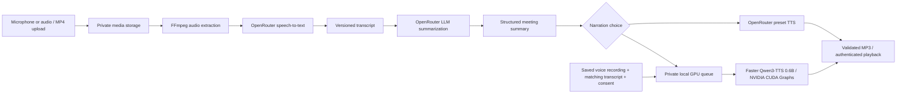

# SUMX

**AI-Powered Meeting Transcription, Summarization & Voice Narration**

SUMX is a private meeting intelligence platform for colleges and organizations. Record a conversation or upload audio/video, turn it into a transcript and structured meeting minutes, then listen to a narration using a preset voice or a consented personal voice generated locally on an NVIDIA GPU.

The application combines a React workspace, a FastAPI API, durable processing workers and a local SQLite database. Cloned-voice reference recordings stay on the local computer; OpenRouter handles transcription, summarization and preset narration.

## Features

- **Meeting capture:** microphone recording, pause/resume, timer, live microphone visualization, playback and upload retry.
- **Audio/video upload:** MP3, WAV, M4A, AAC, FLAC, Ogg, WebM, MP4 and MOV, subject to FFmpeg codec support. Defaults: 250 MB and four hours.
- **Transcription:** OpenRouter speech-to-text, versioned editable transcripts, search and timestamps when the provider supplies them.
- **Meeting intelligence:** concise, standard or detailed summaries, discussion points, decisions, action items, missing owner/deadline handling, unresolved issues and follow-up.
- **Narration:** model-supported OpenRouter preset voices and local Faster Qwen3-TTS 0.6B custom voices; MP3 playback and download.
- **Private voice library:** consented reference recording, editable matching transcript, real previews, search, rename and permanent deletion.
- **Live GPU progress:** actual completed text segments, streamed audio activity/duration, elapsed time, model/GPU labels, refresh recovery and retry. Completion reaches 100% only after final audio validation and storage.
- **Meeting history:** searchable meetings, version-aware narration, text exports, source-retention choices and deletion.
- **Access control:** Google Identity Services popup login, verified Google ID tokens, local active-email allowlist and separate administrator password authentication.
- **Administration:** access management, usage monitoring, per-meeting costs, STT/LLM/TTS breakdowns, model costs, participant details, date filters and CSV exports.
- **Consistent light interface:** Apple-inspired white surfaces, neutral sidebar, accessible typography, keyboard controls and reduced-motion support.

The implemented local cloning path supports ten Qwen languages; voice similarity and naturalness require listening review. CUDA Graph support was tested on one RTX 3060 workstation, not every NVIDIA configuration. No production hosting or CI status is implied.

## Technology stack

These are the installed/locked versions used for verification, rather than inferred versions from package ranges.

| Area | Implementation |
| --- | --- |
| Frontend | React / React DOM 19.3.1, Vite 7.3.7, TypeScript 5.9.3, React Router 7.18.5 |
| Backend | Python 3.13, FastAPI 0.162.0, Pydantic Settings, HTTPX |
| Persistence | SQLite, SQLAlchemy 2.0.44, Alembic 1.17.2; migrations included |
| Authentication | Google Identity Services, google-auth token verification, Argon2id admin passwords, HttpOnly session cookies |
| Remote AI | OpenRouter Whisper Large V3, configured DeepSeek summarization, Voxtral Mini TTS presets |
| Local cloned speech | Faster Qwen3-TTS 0.5.4, qwen-tts-hf 0.1.1.post1, Qwen3-TTS 0.6B Base |
| Isolated GPU runtime | Python 3.12, PyTorch / torchaudio 2.10.0+cu128, Transformers 5.15.1, BF16, SDPA, CUDA Graphs |
| Media | FFmpeg / FFprobe; FFmpeg 8.0 was exercised during development |
| Checks | pytest, Ruff, ESLint, TypeScript and Playwright with Chrome |

SQLite is the configured database. PostgreSQL is not bundled or required; configuring another SQLAlchemy database would also require its driver and separate deployment validation.

## AI processing architecture



The meeting worker persists checkpoints and reuses completed work on safe retries. The local GPU worker loads its model once, reuses reference conditioning, streams real activity measurements and processes one GPU generation at a time. It has no public inference listener. Neither reference recordings nor cloned narration requests are sent to OpenRouter.

## Installation on Windows

### 1. Prerequisites and clone

Install Git, Python **3.13** for the backend, Python **3.12** for the GPU environment, Node.js **22.12+** with npm, and FFmpeg/FFprobe on PATH. Node 24 was used during verification. Local cloned voices additionally require a compatible NVIDIA GPU/driver; the rest of the application can run without a GPU.

FFmpeg can be installed through the verified Windows package identifier:

```powershell
winget install --exact --id Gyan.FFmpeg --source winget
# Open a new terminal if PATH was updated.
ffmpeg -version
ffprobe -version

git clone https://github.com/Parthik880/Sumx.git
cd Sumx
```

This is a private repository: clone with an authorized GitHub account. GitHub CLI users can run `gh auth login` through GitHub's interactive flow. Never paste access tokens or passwords into issues or chat.

### 2. Backend and frontend dependencies

```powershell
py -3.13 -m venv .venv
.\.venv\Scripts\python -m pip install -r backend\requirements-lock.txt

Push-Location frontend
npm ci
Pop-Location
```

The existing `setup.ps1` automates dependency installation and migrations. It creates a random session secret only when the root `.env` does not exist; it preserves existing settings. Create the backend environment above first to select the documented Python version explicitly.

### 3. Environment and database

```powershell
# Create a NEW local environment file only when one does not already exist.
if (-not (Test-Path -LiteralPath .env)) { Copy-Item .env.example .env }
.\.venv\Scripts\python -c "import secrets; print(secrets.token_urlsafe(48))"
```

Put the generated value into `SESSION_SECRET`, then configure `GOOGLE_CLIENT_ID` and `OPENROUTER_API_KEY` in the **root** `.env`. The short `CHANGE_ME` session placeholder intentionally fails startup validation. Do not use production secrets in examples or the frontend.

```powershell
New-Item -ItemType Directory -Force data\media | Out-Null
.\.venv\Scripts\python -m alembic upgrade head
.\.venv\Scripts\python -m backend.cli admin@example.edu
```

The administrator command prompts for a password of at least twelve characters and confirmation. It stores an Argon2id hash. There is no default account, password or approved-email dataset in the repository.

`backend/.env.example` is a backend configuration reference. `frontend/.env.example` documents the optional Vite API proxy. The API and workers always read the root `.env`; they do not automatically read `backend/.env`.

### 4. Google OAuth and OpenRouter

Create a Google OAuth client of type **Web application**, place its client ID in `GOOGLE_CLIENT_ID`, and register these Authorized JavaScript Origins:

- `http://localhost`
- `http://localhost:5173`

The implemented GIS popup credential-callback flow requires **no Authorized Redirect URI**, client secret or authorization-code callback. If the Google app is in Testing, configure its test users separately. Add approved emails in SUMX Administration before user sign-in. For another hostname or port, register that exact origin and update `APP_URL`.

Use a regular OpenRouter **inference** API key with sufficient credit, not a management/provisioning key. The server makes all remote AI requests. The browser receives only the public Google client ID and a short-lived login nonce.

See [Google configuration and verification](docs/GOOGLE_OAUTH.md) and [OpenRouter integration details](docs/OPENROUTER.md).

### 5. Optional local GPU setup

For cloned-voice previews and narration:

```powershell
nvidia-smi
.\setup_qwen_tts.ps1
```

Setup creates `.venv-faster-qwen`, installs CUDA-compatible PyTorch and the pinned Faster dependencies, verifies the GPU, downloads the 0.6B Base model/tokenizer to the local model cache, then loads and warms up CUDA Graphs. It never overwrites the backend environment. Model weights are not part of Git.

If local cloned voices are not needed, set `LOCAL_VOICE_CLONING_ENABLED=false` and omit the GPU setup. Remote transcription, summaries and preset narration still require OpenRouter configuration.

### 6. Start SUMX

```powershell
.\start_sumx.ps1
```

Or use separate terminals:

```powershell
.\run.ps1 api   # FastAPI plus missing local processing/GPU workers
.\run.ps1 web   # Vite frontend
```

Open **http://localhost:5173**. Administrator login is `/admin/login`. Google users use the official button at `/login`.

When launching processes directly, start the durable meeting worker separately with `.\run.ps1 worker`, and the installed GPU worker with `.\run_qwen_tts.ps1`. Direct Uvicorn startup does not implicitly start those processes. Workers are required for queued processing. Startup never reinstalls GPU dependencies or redownloads model weights.

## GPU setup and measured performance

The verified workstation uses an **RTX 3060 with 12 GiB VRAM**, driver 610.88, CUDA-capable PyTorch 2.10.0+cu128, BF16 and SDPA. Both predictor and talker CUDA graphs were captured and replayed. No FlashAttention compilation is required on Windows.

About **2.74 GiB** of peak PyTorch allocation was measured in the repeatable synthetic benchmark; personal-voice jobs reached approximately **3.03 GiB**. Display use and reserved memory add to total device usage. Setup requires at least 4 GiB of free VRAM, which is a readiness check rather than a guarantee for every workload.

```powershell
.\.venv-faster-qwen\Scripts\python -c "import torch; print(torch.__version__); print(torch.cuda.is_available()); print(torch.cuda.get_device_name(0)); print(torch.cuda.get_device_properties(0).total_memory)"
.\run_qwen_tts.ps1
```

The GPU worker keeps the model loaded. Reference conditioning is cached in memory and purged after profile deletion. Capture/warmup failures are reported; the application never silently falls back to standard Qwen or CPU inference.

On the same RTX 3060, reference recording and target text, warm preview generation measured **2.90 s** with first streamed audio at **0.44 s**. The two-segment long-form benchmark measured **17.93 s**, compared with **84.73 s** for the previous standard 1.7B pipeline. These are local measurements, not published results from another GPU. Models/runtime versions produce different waveforms; audio quality parity has not been established by human listening.

See [full benchmark methodology, cold/warm measurements and GPU troubleshooting](docs/FASTER_QWEN_TTS.md). Reproduce the Faster benchmark after generating the documented private synthetic fixture; benchmark media/results are intentionally excluded from the repository.

## Environment variables

All server settings below belong in root `.env`. Defaults are shown in `.env.example` or `backend/config.py`.

| Variable | Purpose | Required? |
| --- | --- | --- |
| `SESSION_SECRET` | Random signing secret, at least 32 characters | Yes |
| `GOOGLE_CLIENT_ID` | Google Web application client ID | For Google login |
| `OPENROUTER_API_KEY` | Backend-only regular inference key | For remote AI |
| `APP_URL` | Exact frontend origin; local default `http://localhost:5173` | Default available |
| `COOKIE_SECURE` | Secure cookie flag; `False` only for local HTTP, `True` for HTTPS | Set for deployment |
| `SESSION_HOURS` | Session lifetime; default 12 | Optional |
| `DATABASE_URL` | SQLAlchemy database URL; defaults to root `data/sumx.db` | Optional |
| `STORAGE_DIR` | Private media directory; defaults to root `data/media` | Optional |
| `OPENROUTER_BASE_URL` | Official endpoint `https://openrouter.ai/api/v1` | Fixed validated value |
| `OPENROUTER_STT_MODEL` | `openai/whisper-large-v3` | Default available |
| `OPENROUTER_SUMMARY_MODEL` | `deepseek/deepseek-v4.1-flash-1017` | Default available |
| `OPENROUTER_TTS_MODEL` | `mistralai/voxtral-mini-tts-2603` for presets | Default available |
| `OPENROUTER_TTS_VOICE` | Default preset voice; `en_paul_neutral` | Optional |
| `OPENROUTER_STT_TIMESTAMPS` | Request supported verbose transcription timestamps | Optional |
| `AUDIO_CHUNK_SECONDS` | Extraction chunk duration; default 180 seconds | Optional |
| `SUMMARY_CHUNK_CHARS` | Transcript summary chunk size; default 24,000 | Optional |
| `TTS_CHUNK_CHARS` | Preset narration text chunk size; default 1,800 | Optional |
| `MAX_UPLOAD_MB` / `MAX_DURATION_SECONDS` | Upload/duration caps; defaults 250 MB / 14,400 seconds | Optional |
| `FFMPEG` / `FFPROBE` | Executable names or paths | Required on PATH or configured |
| `LOCAL_VOICE_CLONING_ENABLED` | Enable local cloned voices; default `true` | GPU workflow only |
| `LOCAL_TTS_PROVIDER` | Must be `faster_qwen3` when enabled | Default available |
| `QWEN_TTS_MODEL` | Must be `Qwen/Qwen3-TTS-12Hz-0.6B-Base` when enabled | Default available |
| `QWEN_TTS_DEVICE` / `QWEN_TTS_ATTENTION` | Supported values `cuda:0` / `sdpa` | Default available |
| `QWEN_TTS_CUDA_GRAPHS` | Must be `true` for local inference | Default available |
| `QWEN_TTS_STREAMING` | Stream audio activity; default `true` | Optional |
| `QWEN_TTS_STREAM_CHUNK_SIZE` | Codec frames per yield; 1–32, default 8 | Optional |
| `QWEN_TTS_MAX_CONCURRENT_JOBS` | Must be 1 | Default available |
| `QWEN_TTS_MODEL_CACHE` | Local checkpoint cache; default `./models/qwen3-tts` | Optional |
| `QWEN_TTS_CHUNK_CHARS` | Narration segment size; 80–600, default 400 | Optional |
| Frontend `API_TARGET` | Vite server's optional API proxy target | Optional; not a browser secret |

No `VITE_*` secret, Google client secret, hosted authentication database or separate direct TTS provider key is required.

## Application usage

1. **Record a meeting:** choose Record meeting, grant microphone access, record/pause/resume, stop and review. Confirm participant consent and create meeting minutes.
2. **Upload an MP4:** choose Upload meeting, select or drop a supported file with an audio track, set the title/detail and consent, then submit.
3. **Review transcript and summary:** follow queued/transcribing/summarizing stages, search/edit the transcript, regenerate minutes if needed, and review decisions/actions. Owner/deadline values are not invented when absent.
4. **Create a personal voice:** open Voice Cloning, name it, record the reference paragraph, review the audio, enter its exact spoken transcript and supported language, and confirm speaker permission. Generate a real preview, listen, then Save Voice.
5. **Generate narration:** open a meeting's Recording & narration tab. Choose Preset Voices or Cloned Voices; search/select a saved voice and generate. Local GPU progress resumes after refresh; completed audio supports playback and MP3 download.
6. **Revisit meetings:** use Overview or Meeting history to search, open, rename or delete meetings and export text. Keep or remove source recordings according to your retention choice.

Supported local voice languages: English, Chinese, Japanese, Korean, German, French, Russian, Portuguese, Spanish and Italian. A saved reference is reused; no custom model is trained.

## Administrator features

Use `/admin/login` with the administrator created by the CLI. Administration manages approved Google emails and active/inactive access. A deactivated user's next protected request is rejected, including existing sessions.

The administrator Analytics page provides date-filtered actual/estimated/pending API costs, STT/LLM/preset-TTS breakdowns, model totals, participant search, per-meeting expansion, CSV exports and reconciliation of provider generation costs. Decimal accounting and generation IDs prevent floating-point drift and duplicate billing records. Regular users see only their own combined costs.

Local GPU generations record the actual local model, status, characters, audio duration, processing time and peak allocated VRAM. They have **zero external API charge**, remain separate from OpenRouter spending, and do not imply zero hardware/electricity cost. Earlier remote charges remain historical records; they are not included in this repository.

## Project structure

```text
Sumx/
├── backend/
│   ├── main.py / security.py / google_identity.py
│   ├── provider.py / jobs.py / media.py
│   ├── models.py / money.py / analytics.py / schema.py
│   ├── voices.py / local_tts.py
│   ├── qwen_runtime.py / qwen_worker.py / qwen_setup.py
│   ├── benchmark_qwen.py / cli.py / config.py
│   ├── migrations/versions/       # additive schema migrations 0001–0006
│   ├── tests/                    # isolated backend/browser fixtures
│   └── requirements*.txt
├── frontend/
│   ├── src/                      # pages, authentication, voice studio/progress, styles
│   ├── tests/                    # Playwright browser workflows
│   ├── package.json / package-lock.json
│   └── vite.config.ts / playwright.config.ts
├── docs/                         # OAuth, AI, analytics and GPU details
├── .env.example / .gitignore / .gitattributes
├── alembic.ini / pyproject.toml
├── requirements-qwen.txt / requirements-qwen.lock
├── setup.ps1 / setup_qwen_tts.ps1
├── run.ps1 / run_qwen_tts.ps1 / start_sumx.ps1
└── remove_retired_qwen.ps1        # optional cleanup for legacy local installations
```

Local `.env`, databases, models, virtual environments, uploaded media, generated narration, logs and test output are deliberately absent from version control.

## Running tests

```powershell
.\.venv\Scripts\python -m pytest backend\tests -q
.\.venv\Scripts\ruff check backend
.\.venv\Scripts\python -m alembic check

Push-Location frontend
npm run typecheck
npm run lint
npm run build
npm test
Pop-Location
```

Chrome is required by the Playwright configuration. Backend tests and browser fixtures use isolated temporary databases, synthetic microphone/media fixtures and mocked provider responses; they do not use your private application database or credentials. Browser fixture ports are 8100 and 5174. Test-only authentication helpers exist only in the isolated test server.

Real GPU generation and CUDA Graph capture were also exercised locally. See the GPU guide for measured results and the distinction between real hardware checks and mocked automated tests. No CI badge or hosted test status is claimed.

## Troubleshooting

| Symptom | Checks |
| --- | --- |
| Meeting stays queued | Start the meeting worker. `run.ps1 api` starts it locally; direct Uvicorn needs a separate worker. Inspect private `data/worker.*.log`. |
| Google `origin_mismatch` or old redirect error | Use a Web client, register the exact frontend JavaScript origins, keep `APP_URL` consistent and use the official popup button. Do not configure an authorization-code redirect for this implementation. |
| Access denied after successful Google identity | Add/activate the verified email in the local allowlist; Google test-user access is a separate setting. |
| OpenRouter 401 | Check the server key and inference-key type. Management/provisioning keys cannot run model inference. Restart API and meeting worker after key changes. |
| Provider rejects model or request | Check configured model availability, credit and supported request format. Failures are shown; successful content is not fabricated. |
| FFmpeg/file error | Confirm `ffmpeg` and `ffprobe` on PATH, a decodable audio track, permitted format, size/duration limits and configured executable paths. |
| Local GPU unavailable | Check `nvidia-smi`, the isolated Faster PyTorch environment and `data/qwen.*.log`. Run GPU setup before starting the worker. |
| Model or CUDA Graph startup fails | Confirm model cache, CUDA-capable wheels, adequate free VRAM and supported settings. Close GPU-heavy applications and restart; no CPU/standard-model fallback occurs. |
| Conflicting `qwen_tts` imports | Keep standard `qwen-tts` out of `.venv-faster-qwen`; Faster requires `qwen-tts-hf`. Use the setup script's isolated environment. |
| Failed narration | Use Retry narration. Completed safe segments/checkpoints are reused; model changes cannot mix incompatible chunks. |

Restart API and affected workers after changing `.env`. The model cache and private media are distinct; do not delete voice recordings while troubleshooting downloaded weights.

## Privacy and security

- Private media and model caches are not served as public static files. Playback and downloads require ownership checks.
- Google tokens are verified server-side for signature, issuer, audience, expiry, nonce and `email_verified`; email values supplied alone are never trusted.
- SUMX sessions use random opaque tokens, database hashes and HttpOnly SameSite cookies; state-changing requests require the configured Origin and CSRF token.
- Use `COOKIE_SECURE=True`, HTTPS and the exact public origin for deployment. The local HTTP setting is not a production deployment configuration.
- Voice cloning requires explicit speaker permission. SUMX does not silently extract voices from meeting participants. References/transcripts remain local during cloned generation.
- Remote transcription/summarization/preset narration necessarily send the relevant audio/text to OpenRouter and its downstream provider. Review their retention policies for organizational use.
- Source-retention controls and permanent deletion remove application content/media; accounting records and separate backups have their own retention. Protect local database/media/cache directories with filesystem permissions.
- `.gitignore` excludes configuration, credentials, databases/journals, recordings, exports, weights, environments and generated artifacts. Commit safe examples only; keep real credentials in local environment files or your deployment secret manager.

For production, build the frontend and serve it through an HTTPS reverse proxy with SPA history fallback and `/api` forwarding. Keep API/workers under a process supervisor and enforce upload limits and filesystem permissions. Production hosting is not configured by this repository.

## License

No project license has been added. The repository currently has no explicit open-source license grant. Third-party packages, model checkpoints and media tools retain their own licenses; consult those upstream terms separately.
