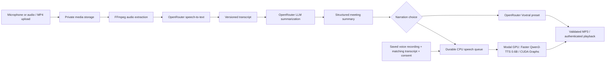

# SUMX

**AI-Powered Meeting Transcription, Summarization & Voice Narration**

SUMX is a private meeting intelligence platform for colleges and organizations. Record a conversation or upload audio/video, turn it into a transcript and structured meeting minutes, then listen to a narration using a preset voice or a consented personal voice generated on private Modal cloud GPUs.

The application combines a React workspace, a FastAPI API, durable processing workers and a local SQLite database. Preset voices use Voxtral TTS 3 through OpenRouter and cloned voices use Faster Qwen3-TTS on Modal.com GPUs, so the FastAPI server needs no GPU, CUDA or model weights. OpenRouter handles meeting transcription, summaries and verification of reference transcripts; reference audio is sent to the configured STT service for that verification.

## Features

- **Meeting capture:** microphone recording, pause/resume, timer, live microphone visualization, playback and upload retry.
- **Audio/video upload:** MP3, WAV, M4A, AAC, FLAC, Ogg, WebM, MP4 and MOV, subject to FFmpeg codec support. No file-size cap by default; the duration limit defaults to four hours.
- **Transcription:** OpenRouter speech-to-text, versioned editable transcripts, search and timestamps when the provider supplies them.
- **Meeting intelligence:** concise, standard or detailed summaries, discussion points, decisions, action items, missing owner/deadline handling, unresolved issues and follow-up.
- **Narration:** Voxtral TTS 3 preset voices and reference-conditioned Faster Qwen3-TTS 0.6B custom voices, with stored previews that play instantly; MP3 playback and download.
- **Private voice library:** consented reference recording, editable matching transcript, real previews, search, rename and permanent deletion.
- **Live GPU progress:** actual completed text segments, validated segment audio duration, elapsed time, model/GPU labels, refresh recovery and retry. Completion reaches 100% only after final audio validation and storage.
- **Meeting history:** searchable meetings, version-aware narration, text exports, source-retention choices and deletion.
- **Access control:** Google Identity Services popup login, verified Google ID tokens, local active-email allowlist and separate administrator password authentication.
- **Administration:** access management, usage monitoring, per-meeting costs, STT/LLM/TTS breakdowns, model costs, participant details, date filters and CSV exports.
- **Consistent light interface:** Apple-inspired white surfaces, neutral sidebar, accessible typography, keyboard controls and reduced-motion support.

The cloning path supports ten Qwen languages; voice similarity and naturalness require listening review. No production hosting or CI status is implied.

## Technology stack

These are the installed/locked versions used for verification, rather than inferred versions from package ranges.

| Area | Implementation |
| --- | --- |
| Frontend | React / React DOM 19.3.1, Vite 7.3.7, TypeScript 5.9.3, React Router 7.18.5 |
| Backend | Python 3.13, FastAPI 0.162.0, Pydantic Settings, HTTPX |
| Persistence | SQLite, SQLAlchemy 2.0.44, Alembic 1.17.2; migrations included |
| Authentication | Google Identity Services, google-auth token verification, Argon2id admin passwords, HttpOnly session cookies |
| Remote AI | OpenRouter Whisper Large V3 and configured DeepSeek summarization |
| Speech | Voxtral TTS 3 presets through OpenRouter; Faster Qwen3-TTS 0.5.4 and 0.6B Base cloning on Modal |
| Modal GPU runtime | Python 3.12, PyTorch / torchaudio 2.10.0+cu128, Transformers 5.15.1, BF16, SDPA, CUDA Graphs |
| Media | FFmpeg / FFprobe; FFmpeg 8.0 was exercised during development |
| Checks | pytest, Ruff, ESLint, TypeScript and Playwright with Chrome |

SQLite is the configured database. PostgreSQL is not bundled or required; configuring another SQLAlchemy database would also require its driver and separate deployment validation.

## AI processing architecture



The meeting worker persists checkpoints and reuses completed work on safe retries. Preset narration calls OpenRouter directly. For cloned voices, the CPU speech worker keeps a durable queue and sends each narration as one private Modal request; the worker loads its model once per container and scales to zero when idle. Complete waveforms are validated before encoding; progress reports actual completed segments. There is no public inference endpoint, and neither voice type falls back to the other provider. Reference verification uses the STT service. Reference recordings are sent to Modal per request, held in a temporary folder during generation and never stored in the image or model volume; in-memory conditioning is scoped to its user, profile and narration job.

## Installation on Windows

### 1. Prerequisites and clone

Install Git, Python **3.13** for the backend, Node.js **22.12+** with npm, and FFmpeg/FFprobe on PATH. Node 24 was used during verification. Speech generation requires a Modal account. No local GPU, CUDA toolkit or PyTorch is needed: the backend is designed to run on a small CPU-only server.

FFmpeg can be installed through the verified Windows package identifier:

```powershell
winget install --exact --id Gyan.FFmpeg --source winget
# Open a new terminal if PATH was updated.
ffmpeg -version
ffprobe -version

git clone https://github.com/Parthik880/Sumx.git
cd Sumx
```

This is a private repository: clone with an authorized GitHub account. GitHub CLI users can run `gh auth login` through GitHub's interactive flow. Never paste access tokens or passwords into issues or chat.

### 2. Backend and frontend dependencies

```powershell
py -3.13 -m venv .venv
.\.venv\Scripts\python -m pip install -r backend\requirements-lock.txt

Push-Location frontend
npm ci
Pop-Location
```

The existing `setup.ps1` automates dependency installation and migrations. It creates a random session secret only when the root `.env` does not exist; it preserves existing settings. Create the backend environment above first to select the documented Python version explicitly.

### 3. Environment and database

```powershell
# Create a NEW local environment file only when one does not already exist.
if (-not (Test-Path -LiteralPath .env)) { Copy-Item .env.example .env }
.\.venv\Scripts\python -c "import secrets; print(secrets.token_urlsafe(48))"
```

Put the generated value into `SESSION_SECRET`, then configure `GOOGLE_CLIENT_ID` and `OPENROUTER_API_KEY` in the **root** `.env`. The short `CHANGE_ME` session placeholder intentionally fails startup validation. Do not use production secrets in examples or the frontend.

```powershell
New-Item -ItemType Directory -Force data\media | Out-Null
.\.venv\Scripts\python -m alembic upgrade head
```

Administrator credentials are provisioned directly in the private deployment database and stored as Argon2id hashes. The interactive password CLI has been removed. There is no default account, password or approved-email dataset in the repository.

`backend/.env.example` is a backend configuration reference. `frontend/.env.example` documents the optional Vite API proxy. The API and workers always read the root `.env`; they do not automatically read `backend/.env`.

### 4. Google OAuth and OpenRouter

Create a Google OAuth client of type **Web application**, place its client ID in `GOOGLE_CLIENT_ID`, and register these Authorized JavaScript Origins:

- `http://localhost`
- `http://localhost:5173`

The implemented GIS popup credential-callback flow requires **no Authorized Redirect URI**, client secret or authorization-code callback. If the Google app is in Testing, configure its test users separately. Add approved emails in SUMX Administration before user sign-in. For another hostname or port, register that exact origin and update `APP_URL`.

Use a regular OpenRouter **inference** API key with sufficient credit, not a management/provisioning key. The server makes all remote AI requests. The browser receives only the public Google client ID and a short-lived login nonce.

See [Google configuration and verification](docs/GOOGLE_OAUTH.md) and [OpenRouter integration details](docs/OPENROUTER.md).

### 5. Modal speech setup

Authenticate once, then deploy the GPU workers from the project root:

```powershell
.\.venv\Scripts\python -m modal token new
.\.venv\Scripts\python -m modal deploy -m modal_service.modal_tts
```

On a server, create a Modal token and set `MODAL_TOKEN_ID` and `MODAL_TOKEN_SECRET` in the root `.env` instead of using `~/.modal.toml`. They are read only by the backend speech worker and must never be placed in the frontend or committed. The first generation downloads both checkpoints into the persistent `sumx-tts-models` Modal Volume, so later containers reuse them.

Generate the stored preset previews once per deployment. This is the only step that creates them:

```powershell
.\.venv\Scripts\python -m backend.preset_previews
```

Redeploying affects only the `sumx-tts` Modal app; restart nothing else unless `.env` or backend code changed. If speech is not needed, set `TTS_ENABLED=false`. Remote transcription and summaries still require OpenRouter configuration.

### 6. Start SUMX

```powershell
.\start_sumx.ps1
```

Or use separate terminals:

```powershell
.\run.ps1 api   # FastAPI plus missing meeting and speech queue workers
.\run.ps1 web   # Vite frontend
```

Open **http://localhost:5173**. Administrator login is `/admin` (`/admin/login` remains an alias). Google users use the official button at `/login`.

When launching processes directly, start the durable meeting worker with `.\run.ps1 worker` and the speech queue worker with `.\run.ps1 tts` (on Linux: `python -m backend.jobs` and `python -m backend.tts_worker`). Direct Uvicorn startup does not start those processes, and both are required for queued processing.

## Changing the Modal GPU

File: `modal_service/config.py`

Setting:

```python
MODAL_GPU = ["A100", "L40S", "L4", "A10"]
```

Modal tries the list from left to right and uses the first type it can provision. `CloneTTS` uses this setting, and this is the only place that selects the TTS GPU. Preset voices use no GPU of yours. The order is a preference: in testing, Modal allocated A100 in 5 of 8 cold starts and A10 in the other 3.

- **Reorder:** put your preferred GPU first, for example `["A10", "A100", "L40S", "L4"]`.
- **Remove:** delete an entry, for example `["A100", "A10"]`.
- **Use one GPU only:** `MODAL_GPU = "A10"`. Requests then wait if that GPU is unavailable.

After saving the file, redeploy:

```powershell
.\.venv\Scripts\python -m modal deploy -m modal_service.modal_tts
```

New containers use the new list. A running container keeps its GPU until it goes idle and shuts down. Use Modal's exact identifiers: `T4`, `L4`, `A10`, `L40S`, `A100` or `A100-40GB`. Modal's `A100` can allocate either the 40 GB or the 80 GB card. Each request records the GPU it actually received, and costs follow that GPU. A GPU missing from `MODAL_GPU_USD_PER_SECOND` in the same file still runs, but its cost stays pending.

The same file sets scale-to-zero, the 300-second idle window, one container per worker and the time limits. Each narration keeps its GPU billed for up to five idle minutes afterward, about $0.21 on an 80 GB A100. Shorten `MODAL_SCALEDOWN_WINDOW` to reduce that at the cost of more cold starts. Measured results, cost semantics and troubleshooting are in the [Modal speech guide](docs/MODAL_TTS.md). Summary modes and spoken action items are covered in [their guide](docs/SUMMARY_MODES.md).

## Environment variables

All server settings below belong in root `.env`. Defaults are shown in `.env.example` or `backend/config.py`.

| Variable | Purpose | Required? |
| --- | --- | --- |
| `SESSION_SECRET` | Random signing secret, at least 32 characters | Yes |
| `GOOGLE_CLIENT_ID` | Google Web application client ID | For Google login |
| `OPENROUTER_API_KEY` | Backend-only regular inference key | For remote AI |
| `APP_URL` | Exact frontend origin; local default `http://localhost:5173` | Default available |
| `COOKIE_SECURE` | Secure cookie flag; `False` only for local HTTP, `True` for HTTPS | Set for deployment |
| `SESSION_HOURS` | Session lifetime; default 12 | Optional |
| `DATABASE_URL` | SQLAlchemy database URL; defaults to root `data/sumx.db` | Optional |
| `STORAGE_DIR` | Private media directory; defaults to root `data/media` | Optional |
| `OPENROUTER_BASE_URL` | Official endpoint `https://openrouter.ai/api/v1` | Fixed validated value |
| `OPENROUTER_STT_MODEL` | `openai/whisper-large-v3` | Default available |
| `OPENROUTER_SUMMARY_MODEL` | `deepseek/deepseek-v4.1-flash-1017` | Default available |
| `OPENROUTER_STT_TIMESTAMPS` | Request supported verbose transcription timestamps | Optional |
| `AUDIO_CHUNK_SECONDS` | Transcription chunk duration; default 180 seconds | Optional |
| `STT_CONCURRENCY` | Chunks transcribed at once, 1–8; default 4 | Optional |
| `STT_OVERLAP_SECONDS` | Extra audio per chunk protecting boundary words, 0–5; default 1.5 | Optional |
| `SUMMARY_CHUNK_CHARS` | Transcript summary chunk size; default 24,000 | Optional |
| `MAX_UPLOAD_MB` / `MAX_DURATION_SECONDS` | Optional upload cap in MB (`0` = no size limit, default) / duration cap (14,400 seconds by default) | Optional |
| `FFMPEG` / `FFPROBE` | Executable names or paths | Required on PATH or configured |
| `TTS_ENABLED` | Enable speech generation; default `true` | Optional |
| `MODAL_TOKEN_ID` / `MODAL_TOKEN_SECRET` | Backend-only Modal credentials; optional where `~/.modal.toml` exists | Required on servers |
| `MODAL_ENVIRONMENT` | Modal environment name; blank uses the default | Optional |
| `TTS_DEFAULT_VOICE` | Default preset voice; `en_paul_neutral` | Optional |
| `OPENROUTER_TTS_MODEL` | `mistralai/voxtral-mini-tts-3-0` for presets | Default available |
| `PRESET_CHUNK_CHARS` | Preset narration chunk size, 200–4000; default 1800 | Optional |
| `PRESET_TTS_CONCURRENCY` | Preset chunks generated at once, 1–8; default 3 | Optional |
| `QWEN_TTS_TIMEOUT` | Longest wait for one speech request, including a Modal cold start; default 3200 seconds | Optional |
| `QWEN_TTS_MODEL` | Must be `Qwen/Qwen3-TTS-12Hz-0.6B-Base` when enabled | Default available |
| `QWEN_TTS_CHUNK_CHARS` | Narration segment size; 80–600, default 240 | Optional |
| Frontend `API_TARGET` | Vite server's optional API proxy target | Optional; not a browser secret |

No `VITE_*` secret, Google client secret, hosted authentication database or separate direct TTS provider key is required.

## Application usage

1. **Record a meeting:** choose Record meeting, grant microphone access, record/pause/resume, stop and review. Confirm participant consent and create meeting minutes.
2. **Upload an MP4:** choose Upload meeting, select or drop a supported file with an audio track, set the title/detail and consent, then submit.
3. **Review transcript and summary:** follow queued/transcribing/summarizing stages, search/edit the transcript, regenerate minutes if needed, and review decisions/actions. Owner/deadline values are not invented when absent.
4. **Create a personal voice:** open Voice Cloning, name it, record the reference paragraph, review the audio, enter its exact spoken transcript and supported language, and confirm speaker permission. Generate a real preview, listen, then Save Voice.
5. **Generate narration:** open a meeting's Recording & narration tab. Choose Preset Voices or Cloned Voices; search/select a saved voice and generate. Progress resumes after refresh; completed audio supports playback and MP3 download.
6. **Revisit meetings:** use Overview or Meeting history to search, open, rename or delete meetings and export text. Keep or remove source recordings according to your retention choice.

Supported local voice languages: English, Chinese, Japanese, Korean, German, French, Russian, Portuguese, Spanish and Italian. A saved reference is reused; no custom model is trained.

## Administrator features

Use `/admin` with a separate **Admin ID and password** provisioned in the private deployment database. `/admin/overview`, `/admin/users/:id` and `/admin/users/add` use their own sidebar and password-session guard. Google users retain the ordinary meeting workspace and cannot enter administration. Existing administrators keep their email as their initial Admin ID after migration.

Overview shows SQL-aggregated user/meeting counts and exact decimal LLM/STT/TTS totals. Search, sort, date filters, pagination and backend-generated CSV exports share the same dataset. Each user detail page shows their meetings, cost chart and paginated provider/model/request records. Historical missing costs are labeled unavailable, while actual zero external API fees remain distinguishable. Exports preserve Unicode, neutralize spreadsheet formulas and include cumulative summaries.

The approval list supports accounts before their first Google sign-in. Approvals/revocations record the administrator and timestamp; revocation ends user sessions without deleting meetings or financial history. Password resets also invalidate sessions. Cookies are HttpOnly/SameSite, Secure is required for HTTPS, and mutations require the allowed Origin plus a session CSRF token. Password login has database-backed per-ID and per-IP rate limits.

Modal generations record GPU execution time, cold starts, retries and an **estimated** cost from published GPU rates. These estimates exclude CPU, memory and idle time and are not invoices; your Modal dashboard is the billing record. Earlier local generations keep their original zero-API-fee records. See [Admin workspace setup and API reference](docs/admin-workspace.md) for account provisioning, migrations, endpoint/filter semantics, cost provenance and current limits.

## Project structure

```text
Sumx/
├── backend/
│   ├── main.py / security.py / google_identity.py
│   ├── provider.py / jobs.py / media.py
│   ├── models.py / money.py / analytics.py / schema.py
│   ├── voices.py / tts_queue.py / tts_worker.py / tts_usage.py
│   ├── clone_speech.py / reference_quality.py / admin.py
│   ├── services/                 # Modal client and bounded async transcription
│   ├── benchmark_modal.py / config.py
│   ├── migrations/versions/       # additive schema migrations 0001–0010
│   ├── tests/                    # isolated backend/browser fixtures
│   └── requirements*.txt
├── modal_service/
│   ├── config.py                 # the only GPU setting
│   ├── modal_tts.py / inference.py / narration.py / speech_contract.py
│   └── requirements.txt          # GPU-only dependencies
├── frontend/
│   ├── src/                      # pages, authentication, voice studio/progress, styles
│   ├── tests/                    # Playwright browser workflows
│   ├── package.json / package-lock.json
│   └── vite.config.ts / playwright.config.ts
├── docs/                         # OAuth, AI, analytics and GPU details
├── .env.example / .gitignore / .gitattributes
├── alembic.ini / pyproject.toml
├── setup.ps1 / run.ps1 / start_sumx.ps1
└── remove_retired_qwen.ps1        # optional cleanup of old local GPU files
```

Local `.env`, databases, models, virtual environments, uploaded media, generated narration, logs and test output are deliberately absent from version control.

## Running tests

```powershell
.\.venv\Scripts\python -m pytest backend\tests -q
.\.venv\Scripts\ruff check backend
.\.venv\Scripts\python -m alembic check

Push-Location frontend
npm run typecheck
npm run lint
npm run build
npm test
Pop-Location
```

Chrome is required by the Playwright configuration. Backend tests and browser fixtures use isolated temporary databases, synthetic microphone/media fixtures and mocked provider responses; they do not use your private application database or credentials. Browser fixture ports are 8100 and 5174. Test-only authentication helpers exist only in the isolated test server.

Automated tests never call Modal; real GPU runs use `python -m backend.benchmark_modal`. See the [Modal speech guide](docs/MODAL_TTS.md) for measured results. No CI badge or hosted test status is claimed.

## Troubleshooting

| Symptom | Checks |
| --- | --- |
| Meeting stays queued | Start the meeting worker. `run.ps1 api` starts it locally; direct Uvicorn needs a separate worker. Inspect private `data/worker.*.log`. |
| Google `origin_mismatch` or old redirect error | Use a Web client, register the exact frontend JavaScript origins, keep `APP_URL` consistent and use the official popup button. Do not configure an authorization-code redirect for this implementation. |
| Access denied after successful Google identity | Add/activate the verified email in the local allowlist; Google test-user access is a separate setting. |
| OpenRouter 401 | Check the server key and inference-key type. Management/provisioning keys cannot run model inference. Restart API and meeting worker after key changes. |
| Provider rejects model or request | Check configured model availability, credit and supported request format. Failures are shown; successful content is not fabricated. |
| FFmpeg/file error | Confirm `ffmpeg` and `ffprobe` on PATH, a decodable audio track, permitted format, size/duration limits and configured executable paths. |
| Voice studio shows the GPU as unavailable | Deploy the Modal app, start the speech worker and check `MODAL_TOKEN_ID`/`MODAL_TOKEN_SECRET` and `data/tts.stderr.log`. There is no local fallback. |
| First preview is slow | A cold Modal container is loading its model. The first deployment also downloads weights into the Modal Volume. |
| Modal container fails to start | Run `modal app logs sumx-tts` and confirm that `MODAL_GPU` is a valid identifier. |
| Failed narration | Use Retry narration. Completed safe segments/checkpoints are reused; model changes cannot mix incompatible chunks. |

Restart API and affected workers after changing `.env`. The model cache and private media are distinct; do not delete voice recordings while troubleshooting downloaded weights.

## Privacy and security

- Private media and model caches are not served as public static files. Playback and downloads require ownership checks.
- Google tokens are verified server-side for signature, issuer, audience, expiry, nonce and `email_verified`; email values supplied alone are never trusted.
- SUMX sessions use random opaque tokens, database hashes and HttpOnly SameSite cookies; state-changing requests require the configured Origin and CSRF token.
- Use `COOKIE_SECURE=True`, HTTPS and the exact public origin for deployment. The local HTTP setting is not a production deployment configuration.
- Voice cloning requires explicit speaker permission. SUMX does not silently extract voices from meeting participants. Synthesis and conditioning remain local. Reference audio is sent to the configured STT provider when verifying its matching transcript.
- Remote transcription and summarization send the relevant audio/text to OpenRouter and its downstream provider. Review their retention policies for organizational use.
- Source-retention controls and permanent deletion remove application content/media; accounting records and separate backups have their own retention. Protect local database/media/cache directories with filesystem permissions.
- `.gitignore` excludes configuration, credentials, databases/journals, recordings, exports, weights, environments and generated artifacts. Commit safe examples only; keep real credentials in local environment files or your deployment secret manager.

For production, build the frontend and serve it through an HTTPS reverse proxy with SPA history fallback and `/api` forwarding. Keep API/workers under a process supervisor and enforce upload limits and filesystem permissions. Production hosting is not configured by this repository.

## License

No project license has been added. The repository currently has no explicit open-source license grant. Third-party packages, model checkpoints and media tools retain their own licenses; consult those upstream terms separately.
